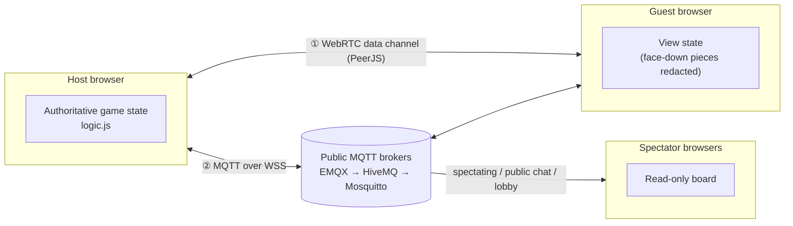

# Banqi Online 暗棋

**English** · [繁體中文](README.zh-TW.md)

Real-time multiplayer Banqi (Chinese dark chess, played with Taiwanese rules) that runs entirely in the browser. No accounts, no installs, and no backend of its own: create a room, share the link, and play.

**Play now: <https://moyu-games.github.io/banqi-online/>**

The whole site is static files on GitHub Pages. Players connect peer-to-peer over WebRTC and fall back to a public MQTT relay when a direct connection is not possible.

---

## Features

**Gameplay**
- Taiwanese rules, including the cannon's jump capture over any piece.
- Take-backs that require the opponent's consent, resignation, and a draw rule.
- Same-device mode for two players sharing one screen.
- Automatic reconnection: refreshing or dropping off rejoins the same game.

**Social**
- A distinct capture animation for each piece type, plus combo effects for consecutive captures.
- Board sound effects synthesized on the fly with the Web Audio API, so no audio files need to load.
- 200+ built-in animated meme stickers; players can add more by pasting a Tenor or Giphy link.
- Taunts: voice-line shortcuts, a "hurry up" nudge, a meme soundboard, trophy bragging, and an automatic quip after a big capture.
- A victory celebration screen.

**Lobby and spectating**
- A public lobby that lists open rooms to join or watch.
- Three spectator access levels: board only, board plus stickers and taunts, or full public chat.
- Separate public and private (player-to-player) chat channels.
- Optional room passwords.

**Interface**
- Light and dark themes.
- Responsive layouts: a bottom action bar on phones in portrait, a side rail in landscape, and a two-column desktop layout that never scrolls.

---

## Architecture



### Authoritative host

- The player who creates the room holds the only true copy of the game and validates every move against the rules.
- At the start of a game the 32 pieces are placed with a Fisher–Yates shuffle (see [Fair shuffle](#fair-shuffle)). Flipping a piece only reveals what was already placed there.
- The guest sends intents only, such as "flip square 12" or "move 3 → 4". The host applies them if they are legal and broadcasts the new state.
- Before the state leaves the host, face-down pieces are stripped from it, so the guest and spectators cannot read hidden pieces even with developer tools.
- Every state carries a monotonically increasing sequence number (`seq`) and a game id (`gid`). Stale or duplicate states are dropped, and a message from a finished game can never pull a player back into it.

### Fair shuffle

Without a server, someone has to deal the board. To stop the host from picking a favourable layout, every online game uses a commit–reveal scheme:

1. The host draws a 128-bit secret `hs` from `crypto.getRandomValues` and publishes only its hash `c = SHA-256(hs)`.
2. After receiving `c`, the guest draws its own seed `gs` and sends it to the host.
3. The layout is a Fisher–Yates shuffle driven by a PRNG (sfc32) seeded with `SHA-256(hs | gs)`. The host committed to `hs` before seeing `gs`, and the guest never sees `hs` during play, so neither side can steer where the pieces go.
4. When the game ends, the host reveals `hs`. The guest checks that `SHA-256(hs)` matches the `c` it saved when it sent its seed, that its own `gs` was used, and that every flip it saw matches the layout it can now rebuild. The result appears on the end screen; any mismatch shows a warning, and the note also says how many untouched games the host restarted before this one.

This makes a rigged layout detectable. It cannot stop a host from peeking at face-down pieces in its own browser; that would need a trusted server or a mental-poker protocol. If the guest joins after the first move, that game is dealt by the host alone and the end screen says so.

### Dual transport

| Channel | Technology | Role |
|---|---|---|
| Direct | WebRTC data channel via PeerJS (STUN from Google and Cloudflare) | Lowest latency; used whenever both networks allow it |
| Relay | MQTT 5 over WebSocket (mqtt.js) | Fallback when NAT or a firewall blocks the direct path; fails over across three public brokers |

- Each message goes out on both channels and is de-duplicated by message id on arrival, so losing either channel drops nothing.
- Both sides exchange heartbeat pings that carry the current `seq`. When the host sees that the guest has fallen behind, it resends the latest state.

**Measured move latency** (guest tap until the guest sees the result; median of 8 moves on the live site):

| Path | Median |
|---|---|
| Direct (WebRTC) | 15 ms |
| Relay only (MQTT) | 625 ms |

Over the relay the guest no longer waits for that round trip: a move is drawn the moment it is tapped (it is fully determined by the visible board), and a flip lifts the piece until the host reveals it. Further taps are ignored while an action is in flight, a slow action is re-sent, and if the host refuses a move the board snaps back to the host's state.

### MQTT topic layout

| Topic | Payload |
|---|---|
| `banqi-tw/v1/<room>/{host,guest}` | Moves and game state between the two players |
| `banqi-tw/v1/<room>/watch[-<topicId>]` | Board and events for spectators |
| `banqi-tw/v1/<room>/pub[-<topicId>]` | Public chat |
| `banqi-tw/v1/<room>/aud[-<topicId>]` | Spectator heartbeats for the live audience count |
| `banqi-tw/v1/lobby/<room>` | Lobby listing (retained message) |

- Lobby entries are retained messages, and the host registers an MQTT Last Will. If the host disconnects, the broker clears the listing automatically, so no ghost rooms are left behind.
- On a locked room, the room key is the first 16 hex digits of `SHA-256(room | password)`. It never appears on the relay: topic names carry `topicId = SHA-256("topic|" + key)`, and the spectator, public-chat and audience channels are encrypted with AES-GCM under a key derived from it.

### Security and privacy

Anyone who knows a room code can publish to its relay topics, so the design assumes every relay message may be forged.

- **Every message is signed.** Each browser has its own ECDSA P-256 key per room (WebCrypto). Game, spectator, public-chat and lobby messages are signed, and receivers check the signature before anything else.
- **The host is pinned by its key.** The invite and spectator links carry the host key's fingerprint (`&f=`), and the guest and spectators accept host messages only from that key. A lobby join takes the fingerprint from the signed lobby card. If the host's key ever changes (for example, it cleared its browser data), the guest is told to ask for a new link instead of silently following someone else.
- **The guest is its key.** The seat belongs to the first guest key; messages from any other key get "room full". On a locked room, a new guest proves it knows the password with `SHA-256(key | guestFingerprint)`, which is useless to anyone who copies it.
- **Strict input checks.** Moves must be integer squares on the board, so a crafted move can't skip a turn or pollute JavaScript prototypes. Incoming game states are validated field by field, and actions are stamped with their game and move number, so a late or replayed action can't land in a newer game.
- **Spectator events are allow-listed.** Stickers, reactions, and taunts forwarded to spectators are checked against the built-in sets. External links must be Tenor or Giphy URLs, and all text is HTML-escaped before display. In public chat, the "host" and "guest" labels are shown only for the matching keys.
- **No photo uploads.** To keep private photos from leaking, stickers come only from the built-in set or Tenor/Giphy links.
- **Pinned third-party code.** PeerJS and mqtt.js are loaded at exact versions with Subresource Integrity hashes.
- **Cookie-free analytics.** Page visits are counted with Cloudflare Web Analytics, which sets no cookies and collects no personal data.
- **Chat is not stored.** Messages live only in the players' browsers, and the host clears its relay data on leaving.

Known limits, stated plainly:

- **Private chat and the game channel are signed but not encrypted.** Spectators never receive them, but someone listening on the public broker who knows the room code can read them. Don't share sensitive information in chat.
- **Anyone can wipe a retained message.** A blank retained publish can hide a lobby card or spectator board until the host republishes it (every 30 seconds). It can't fake one.
- **The host's browser holds the full board.** The fair shuffle stops the host from choosing the layout, and a swapped commitment is detected, but the host could still peek at face-down pieces. This is the inherent trade-off of a serverless design: fine between friends, not suitable for games played for stakes.

### Front end

- A single `index.html` with vanilla JavaScript: no framework and no build step.
- Board cells are created once and then patched in place, changing only the classes and pieces that differ, so nothing flickers.
- Animations touch only `transform` and `opacity`, with `will-change` hints. Under 4× CPU throttling, which simulates a mid-range phone, every effect holds 60 fps with zero dropped frames.
- The piece font is loaded with the Google Fonts `text=` parameter, so only the dozen or so characters used on the board are downloaded.
- Each release bumps `version.txt`. On load, the page compares versions and reloads itself if a newer one is live, so players never get stuck on a stale cache.

### Testing

- Rule unit tests in Node (`test/logic.test.js`).
- End-to-end tests that drive several headless Chrome tabs over the Chrome DevTools Protocol. They cover host and guest play, reconnection, spectating, passwords, phone layouts, forged-message attacks, a host tab crashing mid-game, instant feedback over the relay (including dropped and refused moves), the fair shuffle (including a cheating host), and frame timing under CPU throttling.

---

## Project structure

```
index.html        UI, networking, effects, and sound (single file)
logic.js          Banqi rules as pure functions, shared by the browser and Node
stickers.js       Built-in sticker catalogue and tabs
stickers/         Built-in meme stickers (WebP)
voice/            Taunt voice lines
version.txt       Release number used for update detection
test/             Rule unit tests
```

## Local development

Any static file server works, for example:

```bash
python -m http.server 8765
```

Then open `http://localhost:8765/`. Add `?relay` to the URL to force the MQTT relay only, or `?p2p` to force the direct channel only, which makes it easy to test each transport on its own.

Run the rule tests:

```bash
node test/logic.test.js
```

## Rules

- A 4 × 8 board with 16 pieces per side. All pieces start face down in random positions.
- The first piece flipped decides the flipping player's color.
- On each turn a player either flips a piece or moves one of their own pieces one square orthogonally.
- Ranks from high to low: General, Advisor, Elephant, Chariot, Horse, Cannon, Soldier (帥 仕 相 俥 傌 炮 兵 for red; 將 士 象 車 馬 包 卒 for black). A piece captures equal or lower ranks, with one exception: a Soldier can capture the General, but the General cannot capture a Soldier.
- A Cannon captures by jumping over exactly one piece, face up or face down, at any distance and regardless of rank.
- A player wins by capturing every opposing piece or leaving the opponent with no legal move. Fifty consecutive moves without a flip or a capture is a draw.

---

Meme images, stickers, and sound clips belong to their original creators and are used here for private entertainment only.
