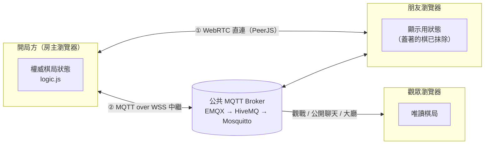

# 暗棋對戰 Banqi Online

[English](README.md) · **繁體中文**

在瀏覽器裡跟朋友線上下台灣暗棋。不用註冊，也不用裝 App，開一局、把連結傳給朋友就能開始。

**立即遊玩：<https://moyu-games.github.io/banqi-online/>**

整個網站都是靜態檔案，放在 GitHub Pages 上，沒有自己的後端伺服器。兩台裝置優先直接連線，連不上時改走公共 MQTT 中繼。

---

## 功能

**對戰**
- 台灣暗棋規則：翻棋、吃子，炮隔一子打。
- 悔棋需要對手同意；可以認輸，也有和棋判定。
- 有同裝置雙人模式，兩個人輪流用同一台下。
- 重新整理或斷線後會自動接回原本的棋局。

**互動**
- 每種棋子有自己的吃子特效，連吃有連擊效果。
- 棋盤音效用 Web Audio 即時合成，不必載入音檔。
- 內建 200 多張會動的梗圖貼圖，也可以貼 Tenor 或 Giphy 的連結加入新貼圖。
- 嘲諷功能：語音快捷鍵、催棋、音效板、炫耀戰利品，大吃一子後還會自動補一句。
- 勝利時有慶祝畫面。

**大廳與觀戰**
- 大廳會列出公開的房間，可以直接加入或觀戰。
- 觀戰權限分三級：只看棋盤、可以傳貼圖和嘲諷、可以參與公開聊天。
- 聊天分成公開頻道和對手之間的私人頻道。
- 房間可以設密碼。

**介面**
- 支援亮色和深色主題。
- 依裝置調整版面：手機直拿時操作按鈕在底部，橫拿時移到右側；電腦版不用上下捲動。

---

## 技術架構



### 權威主機模型

- 開局的一方保存唯一的真實棋局，也負責驗證規則。
- 開局時用 Fisher–Yates 洗牌決定 32 顆棋子的位置（見下方「公平洗牌」），之後翻棋只是把已經排好的棋子翻開。
- 朋友那邊只送出操作，例如「翻第 12 格」或「從 3 走到 4」，由開局方判斷合不合法，再廣播新的棋局。
- 傳給朋友和觀眾的棋局會先抹掉蓋著的棋子內容，他們打開開發者工具也看不到底牌。
- 每個狀態都帶有遞增的序號 `seq` 和局號 `gid`。舊的或重複的訊息會被丟掉，換新局後也不會被舊局的訊息拉回去。

### 公平洗牌

沒有伺服器，總得有一方負責洗牌。為了讓開局方沒辦法挑對自己有利的排法，每一局線上對戰都用「先承諾、後公開」的做法：

1. 開局方用 `crypto.getRandomValues` 產生 128 位元的密鑰 `hs`，只公布它的雜湊值 `c = SHA-256(hs)`。
2. 朋友收到 `c` 之後，自己產生一組亂數 `gs` 傳給開局方。
3. 棋盤用 `SHA-256(hs | gs)` 當種子的亂數產生器（sfc32）做 Fisher–Yates 洗牌。開局方在看到 `gs` 之前就已經鎖定 `hs`，朋友在對局中也看不到 `hs`，所以哪一方都控制不了棋子的位置。
4. 對局結束時，開局方公開 `hs`。朋友那邊會自動檢查三件事：`SHA-256(hs)` 是否等於自己送出亂數時記下的 `c`、洗牌有沒有用到自己的 `gs`、自己看到的每一次翻棋是否都符合重建出來的開局排法。結果顯示在結算畫面上，對不上就會跳出警告；結算畫面也會註明房主在這局之前重開過幾次還沒下的局。

這樣做能抓到被動過手腳的排法，但擋不住開局方在自己的瀏覽器裡偷看蓋著的棋，那需要可信任的伺服器或「心理撲克」協定。如果朋友在第一步之後才加入，那一局就由開局方單獨洗牌，結算畫面也會註明。

### 雙通道傳輸

| 通道 | 技術 | 用途 |
|---|---|---|
| 直連 | WebRTC DataChannel（PeerJS，STUN 用 Google 和 Cloudflare） | 延遲最低，兩邊網路允許時優先使用 |
| 中繼 | MQTT 5 over WebSocket（mqtt.js） | 直連被 NAT 或防火牆擋住時的備援，三個公共 broker 依序切換 |

- 同一則訊息兩條通道都會送，收到時依訊息 id 去重，所以其中一條斷掉也不會漏訊息。
- 雙方定期送心跳 ping，裡面帶目前的 `seq`。發現朋友的棋局落後，開局方會主動補送最新狀態。

**實測點棋延遲**（朋友點下去到看到結果，正式網址 8 步取中位數）：

| 路徑 | 中位數 |
|---|---|
| 直連（WebRTC） | 15 ms |
| 只走中繼（MQTT） | 625 ms |

走中繼時，朋友不用再乾等這段來回：移動在點下去的瞬間就畫出來，因為結果完全由看得到的棋盤決定；翻棋則先讓棋子浮起來，等開局方揭曉。等待期間其他點擊都會被擋掉，太慢就自動重送；開局方拒絕的話，棋盤會跳回開局方的狀態。

### MQTT 主題設計

| 主題 | 內容 |
|---|---|
| `banqi-tw/v1/<房號>/{host,guest}` | 對戰雙方的操作與棋局 |
| `banqi-tw/v1/<房號>/watch[-<頻道代號>]` | 給觀眾的棋局與事件 |
| `banqi-tw/v1/<房號>/pub[-<頻道代號>]` | 公開聊天 |
| `banqi-tw/v1/<房號>/aud[-<頻道代號>]` | 觀眾心跳，用來計算線上人數 |
| `banqi-tw/v1/lobby/<房號>` | 大廳房間資訊（retained 訊息） |

- 大廳資訊用 retained 訊息保存，房主另外設定 MQTT Last Will。房主斷線時 broker 會自動清掉這筆房間，大廳不會留下殭屍房。
- 有密碼的房間，房間金鑰是 `SHA-256(房號 | 密碼)` 的前 16 碼。金鑰本身不會出現在中繼上：頻道名稱用的是 `SHA-256("topic|" + 金鑰)` 算出的頻道代號，觀戰、公開聊天和觀眾心跳的內容也會用從金鑰導出的 AES-GCM 金鑰加密。

### 安全與隱私

只要知道房號，任何人都能往這間房的中繼頻道發訊息，所以設計上假設中繼上的每一則訊息都可能是偽造的。

- **每則訊息都有數位簽章**：每個瀏覽器在每間房都有自己的 ECDSA P-256 金鑰，用瀏覽器內建的 WebCrypto 產生。對戰、觀戰、公開聊天和大廳的訊息都會簽章，收到時先驗證簽章才處理。
- **用金鑰認房主**：邀請連結和觀戰連結都帶著房主金鑰的指紋（`&f=`），朋友和觀眾只接受這把金鑰簽的房主訊息。從大廳加入的人，指紋取自有簽章的大廳卡片。如果房主的金鑰變了，例如清除了瀏覽器資料，朋友那邊會提示「向房主要新的邀請連結」，不會默默跟著別人走。
- **用金鑰認朋友**：座位屬於第一個加入的朋友金鑰，其他金鑰送來的訊息只會收到「房間已滿」。有密碼的房間，新朋友要用 `SHA-256(金鑰 | 朋友指紋)` 證明自己知道密碼，別人抄走這串也沒用。
- **嚴格檢查輸入**：棋步必須是棋盤上的整數格位，偽造的棋步不能跳過回合，也不能污染 JavaScript 的原型。收到的棋局會逐欄檢查格式；棋步會附上局號和步數，太晚到或被重播的棋步不會套進新的一局。
- **觀眾只能看到白名單內的事件**：轉給觀眾的貼圖、表情和嘲諷都要先比對內建清單。外部連結只接受 Tenor 和 Giphy 的網址，顯示前也會先跳脫 HTML。公開聊天裡的「房主」「玩家」標籤，只會出現在金鑰對得上的訊息。
- **不能上傳照片**：為了避免私人照片外流，貼圖只能用內建的或 Tenor、Giphy 的連結。
- **第三方程式碼鎖定版本**：PeerJS 和 mqtt.js 都鎖定版本，並附上 Subresource Integrity 雜湊值。
- **不用 cookie 的流量統計**：用 Cloudflare Web Analytics 計算瀏覽次數，不設 cookie，也不收集個人資料。
- **聊天不保存**：聊天紀錄只存在雙方的瀏覽器裡，房主離開時會清掉中繼上的資料。

老實說還有這些限制：

- **私人聊天和對戰頻道有簽章，但沒有加密**：觀眾收不到，但在公共中繼上監聽、又知道房號的人可以讀到內容。不要在聊天裡傳敏感資訊。
- **保留訊息可以被清掉**：任何人都能發一則空白的保留訊息，暫時蓋掉大廳卡片或觀戰棋盤，直到房主重新發布（每 30 秒一次）。但沒辦法偽造內容。
- **開局方的瀏覽器握有完整棋局**：公平洗牌讓開局方沒辦法挑排法，事後換掉承諾也會被抓到，但還是能偷看蓋著的棋。這是沒有伺服器的架構必然的取捨，適合朋友之間玩，不適合有獎金的比賽。

### 前端

- 單一 `index.html` 加上原生 JavaScript，沒有框架，也沒有建置步驟。
- 棋盤格子只建立一次，之後只更新有變動的 class 和棋子，畫面不會閃。
- 動畫只用 `transform` 和 `opacity`，搭配 `will-change`，在 CPU 降速 4 倍的模擬中階手機上仍維持 60fps。
- 棋子字型用 Google Fonts 的 `text=` 參數，只下載棋盤會用到的十幾個字。
- 每次發布都會更新 `version.txt`。頁面開啟時會先比對版本，發現有新版就自動重新載入，不會卡在舊快取。

### 測試

- 規則單元測試用 Node 跑（`test/logic.test.js`）。
- 端對端測試放在 `test/e2e/`（21 個檔案），透過 Chrome DevTools Protocol 同時操作多個無頭 Chrome 分頁。執行 `node test/e2e/run-all.js` 會自動提供本機網站並全部跑完，詳見 [test/README.md](test/README.md)。涵蓋雙方對戰、斷線重連、觀戰、密碼、手機版面、偽造訊息攻擊、房主分頁當掉、走中繼時的即時回饋（含掉包和被拒絕的情況）、公平洗牌（含開局方作弊），以及 CPU 降速下的幀時間。

---

## 專案結構

```
index.html        介面、連線、特效與音效（單一檔案）
logic.js          暗棋規則：純函式，瀏覽器和 Node 共用
stickers.js       內建貼圖清單與分類
stickers/         內建梗圖（WebP）
voice/            嘲諷語音
version.txt       版本號，給頁面偵測新版用
test/             規則單元測試
```

## 本機開發

用任何靜態伺服器都可以，例如：

```bash
python -m http.server 8765
```

開啟 `http://localhost:8765/`。網址加上 `?relay` 會只走 MQTT 中繼，加上 `?p2p` 只走直連，方便分別測試兩條通道。

跑規則測試：

```bash
node test/logic.test.js
```

跑瀏覽器測試（需要 Node 22 以上和 Chrome，大約 35 分鐘）：

```bash
node test/e2e/run-all.js
```

## 規則說明

- 4 × 8 棋盤，雙方各 16 顆棋子，開局全部蓋著並隨機排列。
- 第一個翻開的棋子決定翻棋那一方的顏色。
- 每回合可以翻一顆棋，或移動自己的一顆棋。棋子只能上下左右走一格。
- 大小順序是帥 > 仕 > 相 > 俥 > 傌 > 炮 > 兵（黑方是將、士、象、車、馬、包、卒），同級可以互吃。例外是兵可以吃帥，帥不能吃兵。
- 炮吃子時必須隔一顆棋跳吃，隔的那顆翻開或蓋著都可以，距離不限，也不看大小。
- 吃光對方的棋，或讓對方無棋可走就獲勝。連續 50 步沒有翻棋也沒有吃子，判為和棋。

---

梗圖、貼圖和音效的版權屬於原作者，這裡只供私人娛樂。
